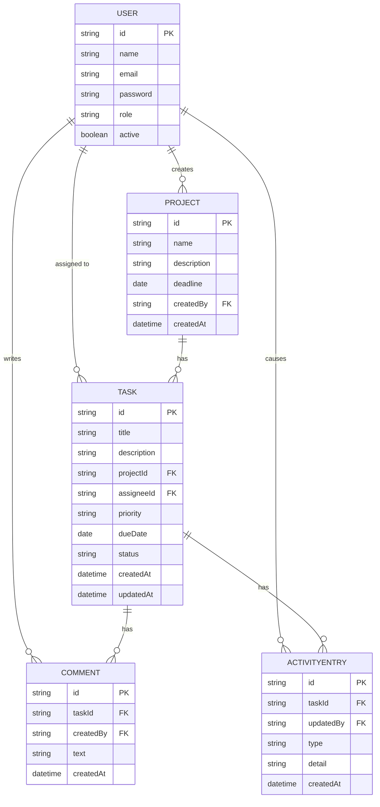

# Team Task Dashboard: Data Model (Design Phase)

*A beginner-friendly guide to how we went from the client meeting to the data model, with the vocabulary and the logic behind every decision.*

---

## 1. Where we are in the journey

Every software project moves through phases. You have finished the first one and started the second.

| Phase | Question it answers | What it produces |
| --- | --- | --- |
| 1. Requirements gathering | **What** should we build? | The **SRS** (Software Requirements Specification) |
| 2. Design | **How** will we build it? | Design documents, including the **data model** |
| 3. Planning | In what order? | Tickets (TD-1 to TD-13) |
| 4. Coding | Build it | Working app in VS Code |
| 5. Testing and deploy | Does it work? Ship it | Live link |

Think of building a house. The client says "I want three bedrooms and a big kitchen" (requirements, the SRS). The architect draws the plan (design). Only then do the builders lay bricks (coding).

Design has several parts. One is UI design (how screens look). The part we are doing now is **data design**: deciding what information the app must remember and how the pieces connect. The result is called the **data model**. A picture of it is called an **ER diagram** (Entity Relationship diagram).

---

## 2. The vocabulary (one idea at a time)

| Word | Meaning | Example in our app |
| --- | --- | --- |
| **Entity** | A real-world thing the app stores data about, that can be told apart from others | User, Project, Task |
| **Attribute** | One detail (property) of an entity | A Task's title, due date, priority |
| **Instance / record** | One single example of an entity | The task "Design the layout" |
| **Id / Primary key** | A unique value that tells one record apart from all others | `t_001` |
| **Relationship** | A connection between two entities | A Task belongs to a Project |
| **Foreign key** | An attribute that stores another record's id, creating the link | A Task's `projectId` |
| **Enum** | An attribute with a fixed set of allowed values | `role` is only admin or employee |
| **Boolean** | An attribute that is only true or false | `active` |
| **Data model / schema** | The full list of entities, attributes and relationships | This document |
| **ER diagram** | The data model drawn as boxes (entities) and lines (relationships) | Coming next |
| **Normalized state** | Each entity stored once in its own flat list, linked only by ids | How our Redux store works |

**The college definition, in plain words:** an entity is a real-world object that can be distinctly identified and about which we store data. Its properties are attributes. The attribute that makes each one distinct is the primary key (the id).

---

## 3. How we found the entities (the logic)

This is the skill worth learning. You do not guess entities; you **read the SRS and look for nouns the app must remember**.

**Step 1: Underline the nouns in the SRS.** Users, admin, employee, project, task, status, priority, comment, history, dashboard, team, board, column.

**Step 2: Ask the test question for each noun:** *"Will the app keep a list of these, with details about each?"*

| Noun | Keep a list with details? | Verdict |
| --- | --- | --- |
| User (admin, employee) | Yes: name, email, password | **Entity** |
| Project | Yes: name, deadline | **Entity** |
| Task | Yes: title, due date, assignee | **Entity** |
| Comment | Yes: text, author, time | **Entity** |
| History line | Yes: who, what, when | **Entity** (ActivityEntry) |
| Status | No, it is just one of 4 values on a task | **Attribute** (enum) |
| Priority | No, just one of 3 values | **Attribute** (enum) |
| Role | No, just admin or employee | **Attribute** (enum) |
| Dashboard, Board | No, these are screens that *show* data, not data itself | **Not an entity** |
| Overdue | No, it is worked out from due date and status | **Not stored** (derived) |
| Project progress | No, worked out from its tasks | **Not stored** (derived) |

**Step 3: Decide one entity or two for similar things.** Admin and Employee look like two entities, but they share the same attributes (id, name, email, password). So we keep **one User entity** with a `role` attribute. We would only split them if they had very different attributes. (In DBMS, a bigger entity with smaller kinds inside is called *specialization*, but we do not need it here.)

**Step 4: List attributes by asking what each person needs to see.** Picture a task card, then the task detail window, for the admin and for the employee. Every piece of information you want on screen is an attribute somewhere.

**Step 5: Find the links.** Use the rule in Section 5.

---

## 4. The five entities

### 4.1 User

Admin and Employee are the same entity; `role` tells them apart.

| Attribute | Type | Notes |
| --- | --- | --- |
| `id` | string | Unique. Even the single admin has one, so rules stay the same for everyone, and other records can point to the admin |
| `name` | string | Display name. Not unique, since two people can share a name |
| `email` | string | Used to log in. Should be unique |
| `password` | string | Plain text only because this is a demo. Real apps store a hash on a server |
| `role` | enum | `admin` or `employee` |
| `active` | boolean | `false` means deactivated by the admin. Never delete users, so old tasks and comments do not break |

### 4.2 Project

| Attribute | Type | Notes |
| --- | --- | --- |
| `id` | string | Unique |
| `name` | string | For example "Medical Website Frontend" |
| `description` | string | Short note |
| `deadline` | date text | A project has a **deadline** (ISO format, like 2026-12-31) |
| `createdBy` | string | **Link:** id of the User (admin) who created it |
| `createdAt` | date-time text | When it was made |

Note: there is no `status` and no progress here. A project's progress is **worked out** from its tasks (done tasks divided by all tasks).

### 4.3 Task

The biggest entity.

| Attribute | Type | Notes |
| --- | --- | --- |
| `id` | string | Unique |
| `title` | string | Shown on the card |
| `description` | string | Shown in the detail window |
| `projectId` | string | **Link:** which Project it belongs to. **Required**, since a task cannot exist without a project |
| `assigneeId` | string or null | **Link:** which User it is given to. **Can be empty** (null) because the admin may create a task before deciding who does it |
| `priority` | enum | `low`, `medium` or `high` (open question: a 1 to 5 scale instead?) |
| `dueDate` | date text | A task has a **due date** |
| `status` | enum | `todo`, `in_progress`, `in_review` or `done`. Always starts as `todo` |
| `createdAt` | date-time text | When it was made |
| `updatedAt` | date-time text | When it last changed |

**Naming habit:** a project has a *deadline*, a task has a *due date*. Same kind of value, different entities. Pick one word per entity and keep it everywhere.

### 4.4 ActivityEntry (the history log)

One entry is one line of history, such as "Priya moved this task from In Progress to In Review at 3 pm". The SRS (FR-41) asks for this so Raj can check who did what.

| Attribute | Type | Notes |
| --- | --- | --- |
| `id` | string | Unique |
| `taskId` | string | **Link:** which Task this line is about |
| `updatedBy` | string | **Link:** id of the User who did it |
| `type` | enum | `created`, `status_changed`, `reassigned`, `edited` |
| `detail` | string | Short text, such as "In Progress to In Review" |
| `createdAt` | date-time text | When it happened. Entries are never edited afterwards |

Who can cause which type:

| Type | Meaning | Who |
| --- | --- | --- |
| `created` | The task was made | Admin |
| `status_changed` | A card moved to another column | Employee or Admin |
| `reassigned` | Task handed from one person to another | Admin |
| `edited` | Title, description, priority or due date changed | Admin |

### 4.5 Comment

| Attribute | Type | Notes |
| --- | --- | --- |
| `id` | string | Unique |
| `taskId` | string | **Link:** which Task it is on |
| `createdBy` | string | **Link:** id of the User who wrote it |
| `text` | string | The comment itself, such as "blocked, waiting for the design" |
| `createdAt` | date-time text | When it was written |

**Why we store only ids, not names:** when the screen needs a name, the app looks up the id in the list of users. If Priya's name changes, it changes in one place and every comment and history line shows the new name. Nothing is copied, so nothing goes out of date.

---

## 5. Relationships

### 5.1 The golden rule

> **The "many" side stores the id of the "one" side.**

One project has many tasks, so each **task** stores a `projectId`. The project never stores a list of its tasks. To find a project's tasks, the app filters all tasks by that `projectId`.

This answers the confusion from earlier: an employee does **not** store a list of tasks, and a project does **not** store a list of employees. The task holds the links.

### 5.2 The three kinds of relationship

| Kind | Meaning | Everyday example | In our app |
| --- | --- | --- | --- |
| **One to many (1:N)** | One record on one side, many on the other | One teacher has many students | One Project has many Tasks |
| **One to one (1:1)** | One record matches exactly one record | One person has one passport | None in v1 (see below) |
| **Many to many (M:N)** | Many on both sides | Students and courses | Users and Projects, indirectly (see below) |

### 5.3 Every relationship in our app

| Relationship | Kind | Which side holds the id |
| --- | --- | --- |
| Project has many Tasks | 1:N | Task stores `projectId` |
| User has many Tasks (as assignee) | 1:N | Task stores `assigneeId` |
| User creates many Projects | 1:N | Project stores `createdBy` |
| Task has many Comments | 1:N | Comment stores `taskId` |
| User writes many Comments | 1:N | Comment stores `createdBy` |
| Task has many ActivityEntries | 1:N | ActivityEntry stores `taskId` |
| User causes many ActivityEntries | 1:N | ActivityEntry stores `updatedBy` |

All seven are one to many. That is why the whole data model is just "the many side holds an id".

### 5.4 About many to many and one to one

**Many to many.** In real life an employee works on many projects, and a project has many employees. That is many to many. But we never store it directly. It appears **through tasks**: a task links one employee to one project. To find a project's team, look at the assignees of its tasks.

If Raj later wanted a task to have **several** assignees at once, then Task and User would become many to many. A database solves that with an extra "in-between" table (called a junction table) holding pairs like (taskId, userId). We avoid this in v1 because the SRS says one task has one assignee.

**One to one.** Our app has none. A classic example would be a User and a separate Profile record, where each user has exactly one profile and each profile belongs to exactly one user. We keep those details inside User instead.

### 5.5 Optional or required?

| Link | Required? | Why |
| --- | --- | --- |
| Task to Project | Required | A task without a project makes no sense. Deleting a project deletes its tasks |
| Task to assignee | Optional (null) | Raj may create a task first and assign it later |
| Comment to Task | Required | A comment lives on a task |
| ActivityEntry to Task | Required | History is about a task |

**Deleting a project (FR-14)** removes the project, all its tasks, and all those tasks' comments and history entries, so nothing is left pointing at something that no longer exists.

---

## 5.5 ER Diagram (Entity Relationship Diagram)

Here is the data model drawn as an ER diagram. Boxes are entities, lines are relationships, and the 1 and N labels show the cardinality (one-to-many).



### Reading the diagram

- **Boxes** = entities (User, Project, Task, Comment, ActivityEntry)
- **Lines** = relationships (all are one-to-many, shown as ||--o{)
- **PK** = Primary Key (the unique id)
- **FK** = Foreign Key (stores another entity's id)
- **Left side (1)** = one side of the relationship
- **Right side (N)** = many side of the relationship

### Text version (if mermaid doesn't render)

```
┌─────────────────┐         ┌─────────────────┐
│      USER       │         │    PROJECT      │
│─────────────────│         │─────────────────│
│ id (PK)         │◄────────│ createdBy (FK)  │
│ name            │  1    N │ id (PK)         │
│ email           │         │ name            │
│ password        │         │ description     │
│ role            │         │ deadline        │
│ active          │         │ createdAt       │
└────────┬────────┘         └────────┬────────┘
         │                           │
         │ 1                         │ 1
         │                           │
         │ N                         │ N
         ▼                           ▼
┌─────────────────┐         ┌─────────────────┐
│      TASK       │         │    COMMENT      │
│─────────────────│         │─────────────────│
│ id (PK)         │◄────────│ taskId (FK)     │
│ title           │  1    N │ id (PK)         │
│ description     │         │ createdBy (FK)──┼──► USER
│ projectId (FK)──┼──► PROJECT │ text            │
│ assigneeId (FK)─┼──► USER  │ createdAt       │
│ priority        │         └─────────────────┘
│ dueDate         │
│ status          │         ┌─────────────────┐
│ createdAt       │         │ ACTIVITYENTRY   │
│ updatedAt       │         │─────────────────│
└────────┬────────┘         │ id (PK)         │
         │                  │ taskId (FK)─────┼──► TASK
         │ 1                  │ updatedBy (FK)──┼──► USER
         │                  │ type            │
         │ N                  │ detail          │
         ▼                  │ createdAt       │
┌─────────────────┐         └─────────────────┘
│  comments &     │
│  activity log   │
│  (above)        │
└─────────────────┘
```

### Key observations

1. **All 7 relationships are one-to-many (1:N)** — this is why the data model is simple. The many side always stores the foreign key.
2. **No many-to-many (M:N)** in v1 — a task has exactly one assignee. If we later allow multiple assignees, we'd need a junction table (TaskAssignee with taskId + userId).
3. **No one-to-one (1:1)** — we keep user details inside the User entity instead of splitting into a separate Profile table.
4. **ActivityEntry is separate from Comment** — even though both are text about a task, they serve different purposes. Comments are user-written notes; ActivityEntries are system-generated history logs.

---

## 6. Why separate lists instead of nesting

You asked whether to nest things (boxes inside boxes). Compare:

**Nested:** a project contains a list of tasks, each task contains a list of comments. Updating one task means digging project, then task list, then the task. Deleting a user means hunting for their name in many places.

**Flat (normalized):** one list of users, one of projects, one of tasks, one of comments, one of history entries. Each is linked only by ids. To update a task, find it by id. To show a project's tasks, filter by `projectId`.

This is called **normalized state**, and it is how Redux Toolkit recommends storing relational data. Redux plays the role of the database here: it is just the browser's memory, and `redux-persist` saves a copy to the browser's storage so data survives a refresh.

---

## 7. What we do NOT store (derived data)

Some things look like data but are calculated from other data each time:

| Looks like data | How it is worked out |
| --- | --- |
| Overdue | `dueDate` is in the past **and** `status` is not `done` |
| Project progress | done tasks divided by all tasks in that project |
| Project complete | all its tasks are `done` |
| Count per status | count tasks grouped by `status` |
| Workload per employee | count tasks where `assigneeId` matches and status is not `done` |

Storing these would risk them going out of date. Calculating them (with selectors in Redux) keeps them always correct.

---

## 8. Decisions we made together

| Decision | Why |
| --- | --- |
| One `User` entity with `role`, not two entities | Admin and employee share the same attributes |
| Admin gets an `id` too | Same rule for everyone; other records point to the admin |
| Project has `deadline`, Task has `dueDate` | One word per entity, used consistently |
| Task stores `projectId` and `assigneeId` | The many side holds the id |
| `assigneeId` can be null | Tasks can be created before assigning |
| History is its own entity (`ActivityEntry`) | It needs its own list; many entries per task |
| History id field named `updatedBy`; comment's is `createdBy` | Names describe the role of the user in that record |
| Store only ids of users, never copied names | Names stay correct in one place |
| Deactivate users, never delete | Old tasks and comments keep working |

---

## 9. Open questions for the client

1. Priority scale: low, medium, high, or numbers 1 to 5?
2. Should one task ever have more than one assignee? (This would make it many to many.)
3. Is a deadline on every project required, or optional?

---

## 10. Summary in your own words

- The **SRS** says what to build. The **data model** says what information the app remembers and how it connects.
- An **entity** is a thing we store data about. **Attributes** are its details. The **id** makes each one unique.
- We found five entities: **User, Project, Task, ActivityEntry, Comment**.
- Every relationship is one to many, and the **many side stores the id of the one side**.
- Things that can be calculated (overdue, progress, counts) are never stored.

---

## 11. Next steps

1. ~~Draw the **ER diagram**~~ — Done! See Section 5.5 above.
2. Design the **state** (which Redux slices hold which entities, and the selectors).
3. Break the work into tickets.
4. Open VS Code and start TD-1.
